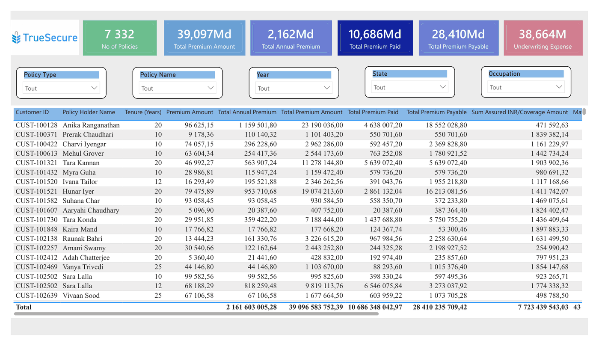
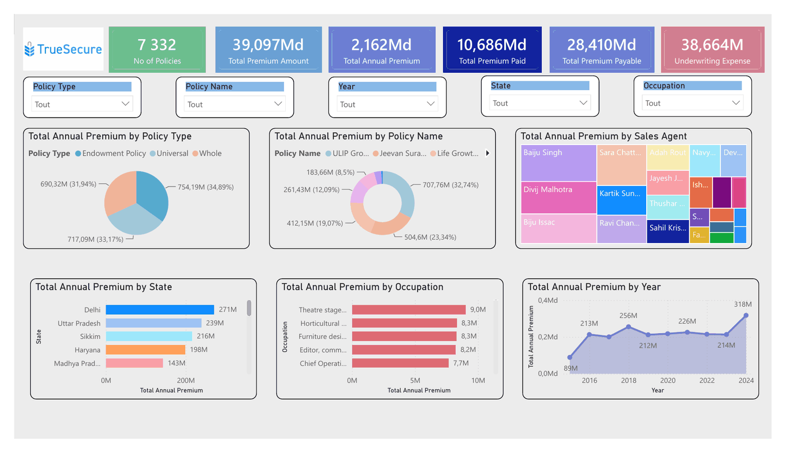
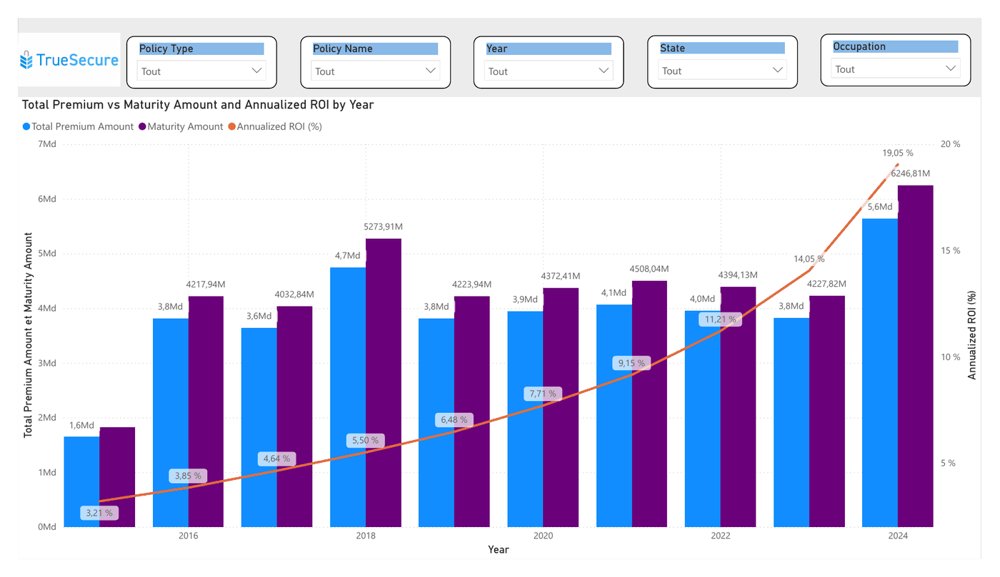
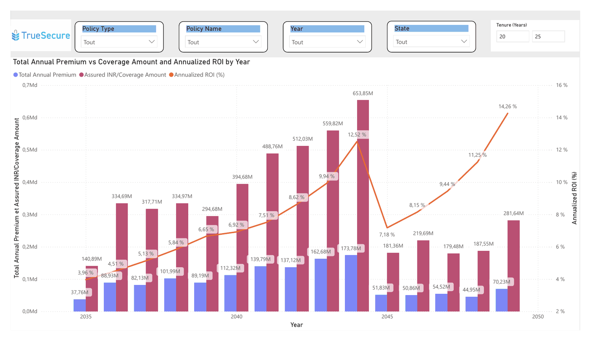
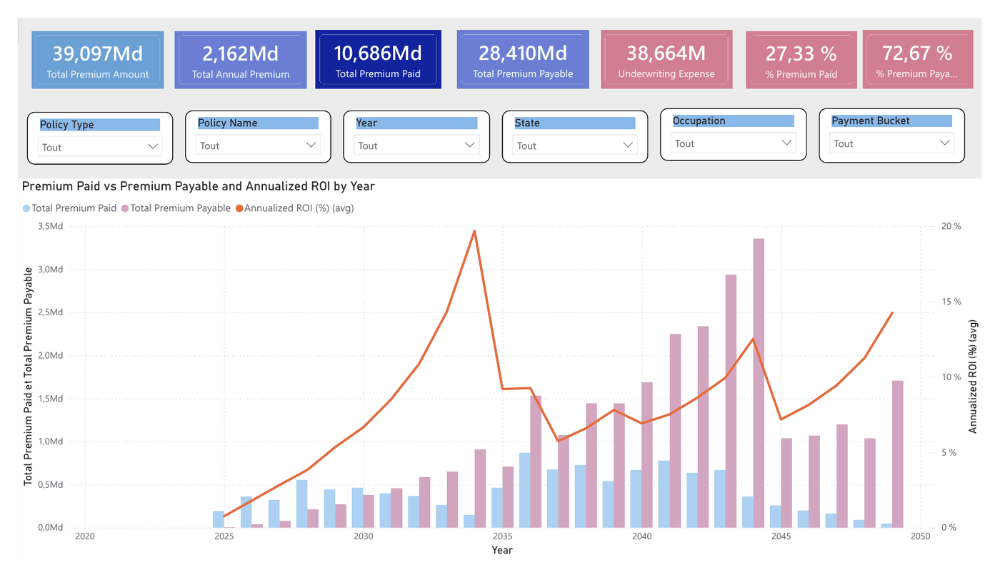

# 🛡️ Tableau de bord Assurance – Primes et rendement des contrats (Power BI)

## 📌 Contexte
Tableau de bord Power BI pour une compagnie d'assurance vie fictive (*TrueSecure*). Il suit les primes encaissées et restant dues sur **7 332 contrats**, et compare ce que les assurés versent à ce qu'ils récupèrent à l'échéance.

## 🎯 Objectif
- Suivre les primes : montant total, primes annuelles, primes payées et restant dues, frais de souscription
- Comprendre d'où vient le chiffre d'affaires : type de contrat, formule, agent commercial, État, profession
- Évaluer la valeur des contrats pour l'assuré : valeur à l'échéance, capital assuré, rendement annualisé

## 🛠️ Outils
- **Power BI** : modèle en étoile, visualisations, filtres synchronisés
- **Power Query** : import et préparation de 7 fichiers CSV

## 🗂️ Modèle de données
Modèle en étoile : une table de faits (les contrats) reliée à 6 tables de dimensions (clients, agents, types de contrat, formules, managers régionaux et zonaux).

## 📊 Le rapport (5 pages)
Filtres communs sur chaque page : type de contrat, formule, année, État et profession.

### 1. Summary
Les indicateurs clés et le détail par assuré : durée, primes, capital assuré, valeur à l'échéance et rendement.

### 2. Insurance Overview
Répartition des primes annuelles par type de contrat, formule, agent, État, profession et année.

### 3. Investment Value vs Maturity Value
Primes versées comparées à la valeur à l'échéance, avec le rendement annualisé moyen par année de souscription.

### 4. Annual Premium vs Protection Value
Primes annuelles comparées au capital assuré, selon la durée du contrat.

### 5. Premium Analysis
Part des primes déjà payées et restant dues, par année et par tranche de paiement.

## 📌 Chiffres clés
- **7 332 contrats** pour **39,1 milliards INR** de primes totales sur la durée des contrats
- **27 %** des primes ont déjà été payées, **73 %** restent à encaisser
- Les 3 types de contrats (Endowment, Universal, Whole) pèsent chacun environ **un tiers** des primes annuelles
- Le rendement annualisé moyen progresse avec l'année de souscription, de **3 %** (2015) à **19 %** (2024)

## 👤 Auteure
Rosine Armelle · [LinkedIn](https://www.linkedin.com/in/rosine-armelle-tinbo-kafando) · [Retour au portfolio](../README.md)
