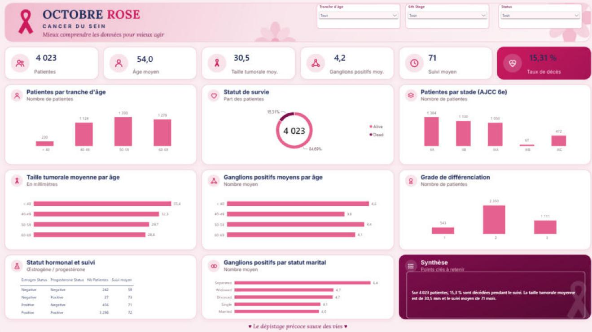
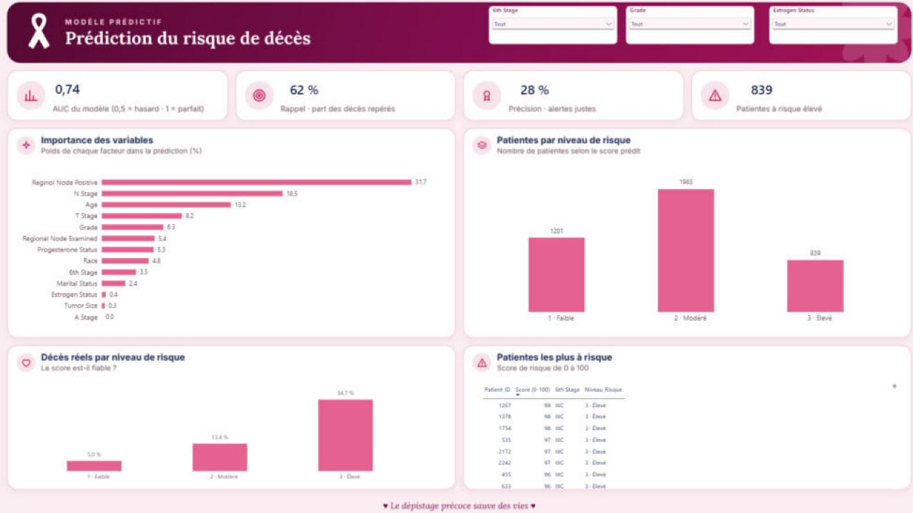

# 🎗️ Cancer du sein – Identifier les patientes à suivre en priorité (Power BI + Python)

## Question métier
Une structure de soins dispose de données cliniques riches (stade, grade, statut hormonal, ganglions atteints), mais pas d'outil pour les exploiter. **Quelles patientes doivent être suivies en priorité ?**

## Données
Registre américain **SEER** sur le cancer du sein ([dataset Kaggle](https://www.kaggle.com/datasets/reihanenamdari/breast-cancer)) : 4 023 patientes après nettoyage, avec leur profil clinique et leur statut à la fin du suivi.

## Démarche
1. **Préparer et fiabiliser les données** sous Power Query : suppression des doublons, tranches d'âge, contrôles de cohérence.
2. **Décrire** la population avec des indicateurs clairs : âge moyen, taille tumorale, ganglions atteints, durée de suivi, taux de décès.
3. **Expliquer** le risque avec les visuels d'analyse de Power BI (influenceurs clés, arbre de décomposition).
4. **Prédire** le risque individuel en Python : régression logistique, validée par validation croisée, puis score de 0 à 100 réintégré dans le rapport Power BI.

## Résultats
- 15,3 % des patientes sont décédées pendant le suivi.
- Le taux de décès passe de **7 % au stade IIA à 38 % au stade IIIC**.
- Le nombre de ganglions atteints est le facteur qui pèse le plus dans le risque.
- Le score distingue clairement les profils : **5 % de décès dans le groupe à risque faible, 35 % dans le groupe à risque élevé**.
- Le modèle repère environ 6 décès sur 10 (AUC de 0,74).

**Recommandation :** prioriser le suivi des 839 patientes classées à risque élevé, en particulier celles aux stades III avec plusieurs ganglions atteints.

## Aperçu du rapport

### Vue d'ensemble

### Facteurs de risque

### Prédiction du risque

## Contenu du dossier
- `captures/` : les 3 pages du rapport Power BI
- `python/Modele_Risque_Cancer_du_Sein.ipynb` : préparation, entraînement et évaluation du modèle, calcul du score
- `python/Metriques_Modele.csv` et `python/Importance_Variables.csv` : résultats exportés vers Power BI

## Limites
Le modèle sert à prioriser le suivi, pas à poser un diagnostic. Il génère des fausses alertes (précision de 28 %) : un score élevé doit déclencher un examen par l'équipe médicale, pas une décision automatique.

## Outils
Power BI (Power Query, DAX) · Python (pandas, scikit-learn) · Excel
