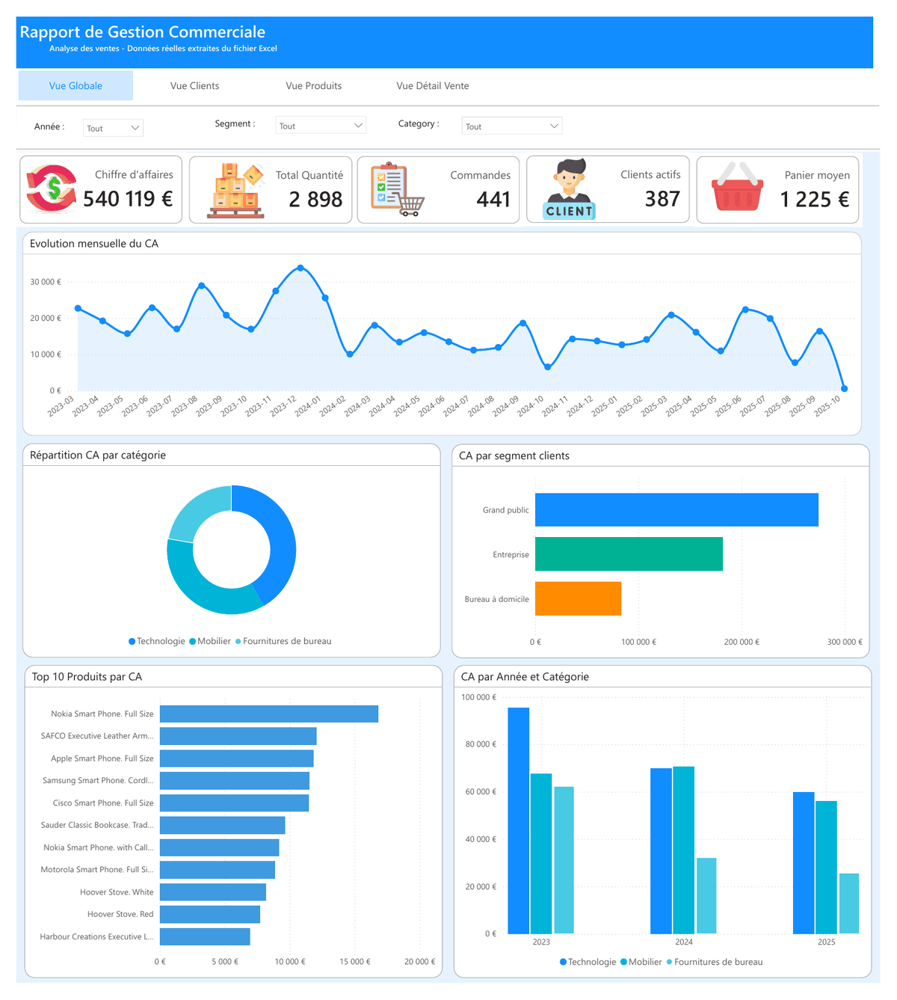
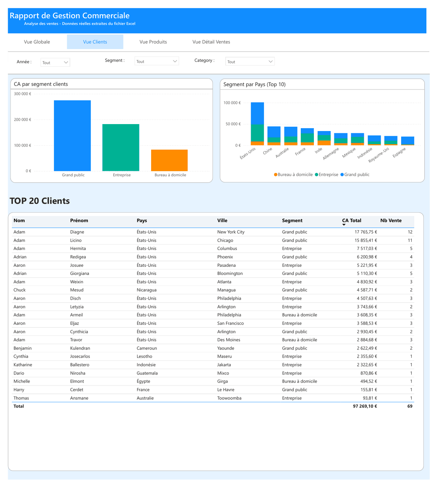
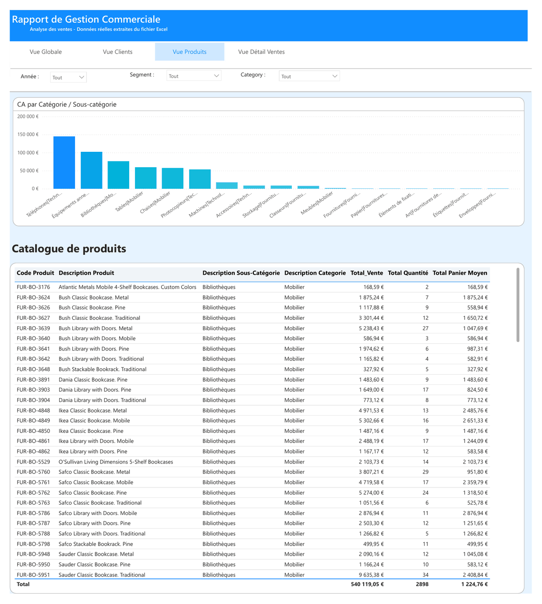
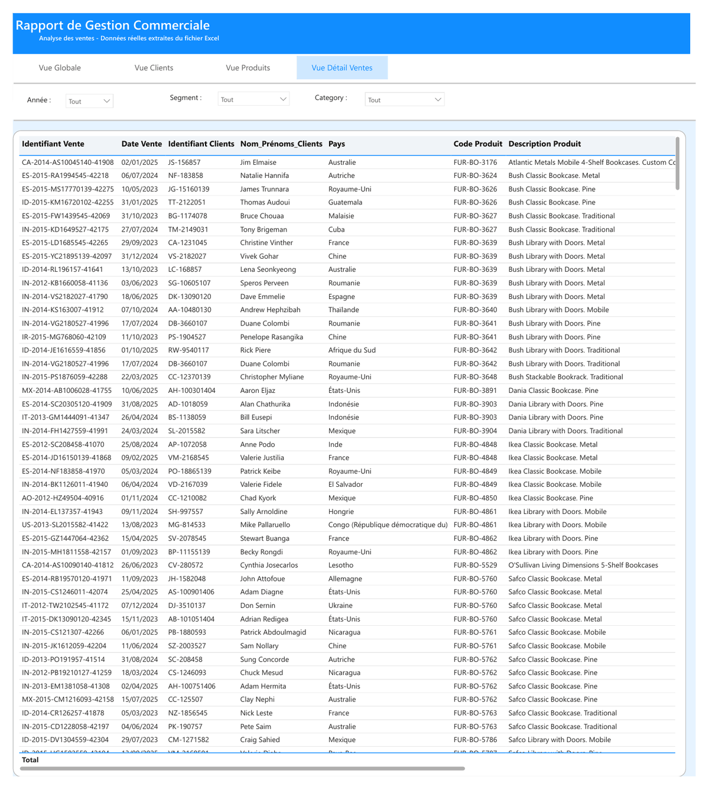

# 📈 Rapport de gestion commerciale – Power BI

## 📌 Contexte
Tableau de bord Power BI de pilotage des ventes, construit à partir de données de ventes extraites d'un fichier Excel (2023-2025). Il permet à un responsable commercial de suivre l'activité et d'identifier les clients et produits qui portent le chiffre d'affaires.

## 🎯 Objectif
- Suivre les indicateurs clés : chiffre d'affaires, quantités, commandes, clients actifs, panier moyen
- Analyser le CA par période, par catégorie, par segment de clientèle et par pays
- Identifier les meilleurs clients et produits

## 🛠️ Outils
- **Power BI** : modélisation des données, mesures DAX, visualisations
- **Power Query** : préparation des données
- **Excel** : source de données

## 📊 Le rapport (4 pages)

Navigation par boutons entre les pages et filtres communs par **année**, **segment** et **catégorie**.

### 1. Vue globale
Les 5 KPI, l'évolution mensuelle du CA, la répartition par catégorie et par segment, le top 10 des produits.

### 2. Vue clients
CA par segment, répartition par pays (top 10) et tableau des 20 meilleurs clients.

### 3. Vue produits
CA par catégorie et sous-catégorie, catalogue des produits avec CA, quantités et panier moyen.

### 4. Vue détail ventes
Détail de chaque vente pour l'analyse ligne à ligne.

## 📌 Chiffres clés
- **540 119 €** de chiffre d'affaires pour **441 commandes** et **387 clients actifs**
- Panier moyen de **1 225 €**
- Le segment **Grand public** génère le CA le plus élevé, devant Entreprise et Bureau à domicile

## 👤 Auteure
Rosine Armelle · [LinkedIn](https://www.linkedin.com/in/rosine-armelle-tinbo-kafando) · [Retour au portfolio](../README.md)
